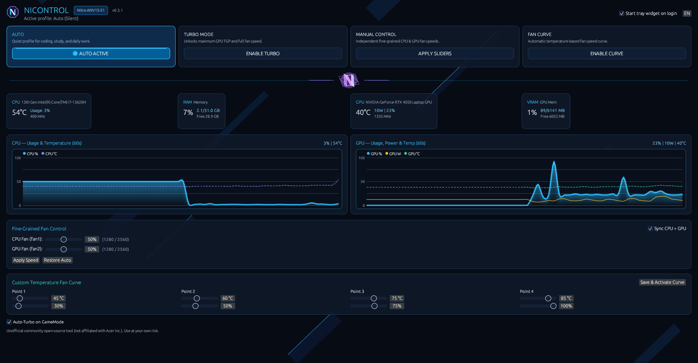

<div align="center">


# Nicontrol

**Lightweight, native Rust Control Center & System Tray for Nitro laptops on Linux**

[](LICENSE)
[](#-installation)
[](https://www.rust-lang.org/)
[](#-internationalization-i18n)

*Dark Crystal Blue aesthetic • Real-time CPU/GPU telemetry • Zero-overhead tray mode*

</div>

---

> **Disclaimer:** **Nicontrol** is an unofficial, community-developed open-source project and is **not affiliated with, endorsed by, or connected to Acer Incorporated**. *Acer*, *Nitro*, and *NitroSense* are trademarks of Acer Inc. This software interacts with hardware fan and power-mode interfaces; **use at your own risk** and always monitor your temperatures.

<div align="center">
  
</div>

---

## Features

* **Power & Thermal Modes**
  * **Auto (Silent / Balanced):** Restores automatic fan curves and standard power limits for quiet daily work and coding.
  * **Turbo Mode:** Unlocks maximum GPU TGP and full fan speed.
  * **Manual Fan Control:** Independent fine-grained sliders (`0%–100%`, with optional CPU + GPU sync and low-speed thermal warning).
  * **Custom Fan Curve:** Automatic temperature-based fan speed curve with linear interpolation and hysteresis.
* **System Tray Widget (`--tray`)**
  * Native `StatusNotifierItem` (`ksni`) tray icon with live CPU & GPU temperature/power tooltip and quick menu.
  * Color-coded badge: **Dark Crystal Blue** (Auto), **Vibrant Orange-Red** (Turbo), **Deep Indigo** (Manual).
  * Left-click to toggle between **Turbo** and **Auto**; right-click for quick menu & GUI launcher.
  * Built-in **Autostart** toggle (`~/.config/autostart/nicontrol.desktop`).
* **Real-time Telemetry & Separated Charts**
  * **CPU Monitor (60s):** Live `CPU %` usage (`/proc/stat`) and `CPU °C` (`coretemp`, `k10temp`, `zenpower`, or `acpitz`).
  * **GPU Monitor (60s):** Live `GPU %`, `GPU W` power draw, and `GPU °C` (`nvidia-smi`).
* **Smart Performance**
  * Rising crystal shard animations run only when the GUI window is visible and **pause completely when minimized**.
* **Internationalization (i18n)**
  * Defaults to **English (`en`)** with built-in **Portuguese (`pt-BR`)** support, auto-detected from system locale (`LC_ALL`/`LANG`) or switchable directly in the UI.

---

## Supported Hardware & Kernel Interfaces

| Component | Supported Interfaces | Notes |
| :--- | :--- | :--- |
| **EC / Fan Control** | `/dev/turbo`, `/dev/fan1`, `/dev/fan2`, `/dev/fan_auto` | Provided by drivers like `acer_nitro_gaming_driver` |
| **Power Profile Fallback** | `/sys/firmware/acpi/platform_profile` | Mainline Linux `acer-wmi` (Auto / Turbo mode switching) |
| **CPU Temp (Intel)** | `coretemp` (`hwmon`) | Intel Core processors |
| **CPU Temp (AMD)** | `k10temp`, `zenpower`, `zenpower3` (`hwmon`) | AMD Ryzen processors (with `acpitz` fallback) |
| **GPU Telemetry** | `nvidia-smi` | Optional; requires proprietary NVIDIA driver |
| **Desktop Notifications** | `notify-send` (`libnotify`) | Optional; recommended for mode-switch alerts |

---

## Installation

### Option 1: Debian / Ubuntu / Mint / Pop!_OS (`.deb` via `apt`)

**Direct `.deb` install** (from [GitHub Releases](../../releases)):
```bash
sudo apt install ./nicontrol_*_amd64.deb
```
*(The `.deb` package automatically installs the desktop icon and `udev` rule in `/lib/udev/rules.d/99-nicontrol.rules`.)*

**Or via the GitHub Pages APT repository** (once `gh-pages` is published):
```bash
curl -fsSL https://m3t4z0d.github.io/Nicontrol/pubkey.gpg | sudo gpg --dearmor -o /usr/share/keyrings/nicontrol.gpg
echo "deb [arch=amd64 signed-by=/usr/share/keyrings/nicontrol.gpg] https://m3t4z0d.github.io/Nicontrol stable main" | sudo tee /etc/apt/sources.list.d/nicontrol.list
sudo apt update && sudo apt install nicontrol
```

### Option 2: Portable `.zip` (Any Linux Distro)

Download `nicontrol-*-linux-x86_64.zip` from [GitHub Releases](../../releases), extract, and run the installer (no Rust toolchain required):

```bash
unzip nicontrol-*-linux-x86_64.zip
cd nicontrol-*-linux-x86_64
chmod +x install.sh
./install.sh
```

### Option 3: Build from Source

Requires the Rust toolchain (`cargo` / `rustc`, 2021 edition) and Linux GUI/D-Bus development headers (`libgl1-mesa-dev`, `libxkbcommon-dev`, `libwayland-dev`, `libdbus-1-dev`):

```bash
git clone https://github.com/M3T4Z0D/Nicontrol.git
cd Nicontrol
chmod +x install.sh
./install.sh
```

---

## Usage

```bash
nicontrol         # Launch the GUI Control Center
nicontrol --tray  # Run the System Tray widget only
```

### Non-root Fan / Turbo Access (`udev` rule)

If you get `Permission denied` on `/dev/turbo` or `/dev/fan*`, ensure your EC kernel module has a `udev` rule granting user write permissions (for example, in `/etc/udev/rules.d/99-nicontrol.rules`):

```udev
KERNEL=="turbo|fan1|fan2|fan_auto", MODE="0666"
```

Reload rules with:

```bash
sudo udevadm control --reload-rules && sudo udevadm trigger
```

---

## Project Structure

```text
src/
├── main.rs            # CLI entrypoint (--tray vs GUI)
├── gui.rs             # eframe / egui Dark Crystal Blue UI, charts & fan curve editor
├── tray.rs            # StatusNotifierItem (ksni) tray icon, quick menu & curve daemon
├── i18n.rs            # English (default) & Brazilian Portuguese (pt-BR) translations
└── hardware/
    ├── mod.rs         # Shared hardware types, FanCurve & state persistence
    ├── linux.rs       # Linux EC/ACPI backends, RTD3-aware GPU polling & hwmon RPM/temp
    └── windows.rs     # Windows backend stub for future releases
```

---

## Roadmap

* [x] Linux GUI + System Tray (`Wayland` & `X11`)
* [x] Intel & AMD CPU temperature support + dynamic hardware detection
* [x] Automated GitHub Releases (`.zip` & `.deb`)
* [x] Internationalization (`en` default + `pt-BR`)
* [ ] Windows support (`.zip` portable release & Windows EC/WMI backend)
* [ ] Additional community translations

---

## Contributing

Contributions are very welcome! See [CONTRIBUTING.md](CONTRIBUTING.md) for guidelines on submitting issues and pull requests.

## License

Released under the [MIT License](LICENSE).
